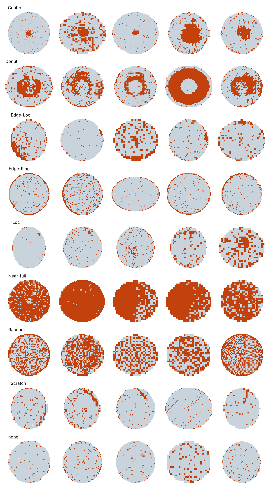
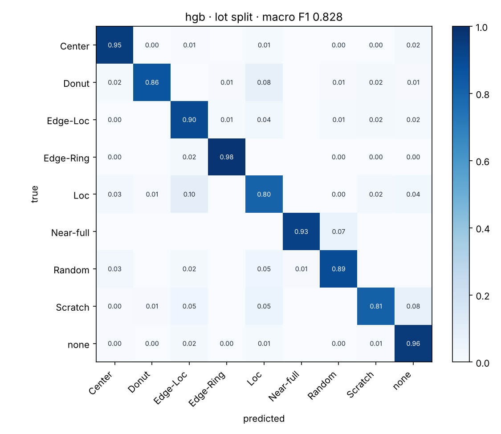

# wafer-defect

[](https://github.com/Akashkushawaha/wafer-defect/actions/workflows/tests.yml)

Classifying wafer-map failure patterns on **WM-811K** (811,457 real wafer maps
from 46,293 production lots), and saying what each pattern points at on the
fab floor.

**Result:** macro F1 **0.83** across 9 classes on 34,601 wafers from lots the
model never saw — Edge-Ring 0.98, Center 0.88, Near-full 0.93 — from 68
hand-built features and a gradient-boosted model that trains in minutes on a
laptop CPU. [Details below](#results).



A wafer map is the result of electrically testing every die on a wafer: pass
or fail, laid out where the die sat. When failures are random, that's normal
yield loss. When they form a *shape* — a ring at the edge, a blob in the
middle, a line — something systematic in the process caused them, and the
shape says which part of the process to look at. This project classifies the
shape and then names the first suspects.

```
$ wafer predict artifacts/model.joblib data/LSWMD.pkl --lot lot2557 --wafer 23
lot lot2557 wafer 23  (tagged: Scratch)
  Scratch    0.97
  none       0.02
  Edge-Loc   0.00

Scratch: A thin linear or arc-shaped trail of failures.
first suspects:
  - Mechanical scratching, classically CMP (pad debris, agglomerated slurry particles)
  - Wafer handling or transfer damage
check next: Check CMP consumables and pad conditioning for the lot; arcs that follow the polish path are a strong CMP signal.
```
<sub>A real wafer from a lot held out of training.</sub>

## Approach

**Hand-built features, not a CNN.** Each map becomes 68 numbers that describe
*where* the failures are and *what shape* they make. The model then learns on
those. This runs on a laptop CPU in minutes, every feature has a physical
meaning you can inspect, and it is the approach of the paper that released
the dataset (Wu, Jang & Chen, *IEEE Trans. Semiconductor Manufacturing*, 2015).

| Block | # | What it captures |
|---|---|---|
| Zone density | 13 | Failure rate in 4 edge bands and a 3×3 interior grid |
| **Radial profile** | 5 | Failure rate in equal-area rings, centre → edge. *Added in this project* |
| Radon transform | 40 | Line sums at every angle. Lines (scratches) peak at one angle; rings don't |
| Geometry | 7 | Size, reach, elongation and solidity of the largest failure cluster |
| Global | 3 | Overall fail fraction, cluster count, how concentrated the failures are |

Two deliberate changes from the paper:

1. **Every feature is size-normalised.** Maps range from 6×21 to 300×202 dies.
   Raw counts would teach the model die size, not pattern.
2. **A radial profile block.** Center, Donut and Edge-Ring differ mainly in
   *which radius* fails — and radius is where process physics shows up
   (spin-coating, CMP pressure zones, edge effects are all radial). It adds
   +0.018 macro F1; see the ablation below.

### Evaluation choices that matter

- **Lot-aware split (default).** Wafers in a lot run through the same tools
  together and can share defects, so a random split risks near-duplicates on
  both sides. `--split lot` keeps each lot on one side; `--split official`
  uses the dataset's own tags; `--split random` is there to measure the
  difference (on WM-811K it turned out to be negligible — see Results).
- **Macro F1 is the headline, not accuracy.** ~85% of tagged maps are `none`,
  so predicting `none` every time scores ~85% accuracy and is useless.
- **Class weighting** throughout, because Near-full is ~0.1% of the data.

## Pattern → process: what the classes mean

| Pattern | Spatial signature | Usual first suspects |
|---|---|---|
| **Center** | Failures around the centre | Centre-out processes: spin-coat/develop, CMP pressure profile, chamber gas/heat distribution |
| **Donut** | Ring at mid-radius | Zone mismatch in a multi-zone heater, chuck or CMP carrier |
| **Edge-Ring** | Ring at the edge | Film roll-off, edge-bead removal, edge etch rate, litho focus near the edge |
| **Edge-Loc** | One patch of the edge | Mechanical contact — clamps, pins, robot end-effector |
| **Loc** | Interior cluster | Particle event or local process excursion |
| **Scratch** | Line or arc | CMP (pad debris, slurry agglomerates) or handling damage |
| **Random** | No structure | Random defect density; baseline yield loss below a threshold |
| **Near-full** | Almost all dies fail | Gross failure — wrong recipe, missed step — or a tester/probe-card problem |

These are first suspects, not diagnoses: a yield engineer confirms by
correlating with tool/chamber history and in-line metrology. Full notes in
[`src/waferdefect/causes.py`](src/waferdefect/causes.py), and `wafer explain <pattern>`.

## Quick start

```bash
python -m venv .venv && source .venv/bin/activate
pip install -e ".[dev]"
pytest                      # 49 tests, ~20 s, no dataset needed
wafer demo                  # whole pipeline on synthetic maps -> demo/
```

### On the real data

Download `LSWMD.pkl` (2.1 GB) from
[Kaggle: WM-811K wafer map](https://www.kaggle.com/datasets/qingyi/wm811k-wafer-map)
into `data/`.

```bash
wafer inspect data/LSWMD.pkl --examples reports/examples.png   # check it loads
wafer featurize data/LSWMD.pkl -o artifacts/features.npz       # ~173k tagged maps
wafer train artifacts/features.npz --split lot --reports reports/
wafer train artifacts/features.npz --split random --reports reports/random/   # compare
wafer predict artifacts/model.joblib data/LSWMD.pkl --lot <lot> --wafer <n>
```

Add `--limit 20000` to `featurize` for a quick first run.

## Results

All 172,950 tagged maps, 68 features, `HistGradientBoostingClassifier` with
balanced class weights. Feature extraction takes ~8 min on 2 CPU cores;
training ~2 min.

| Split | Train / test | Macro F1 | Balanced acc. |
|---|---|---|---|
| **Lot-aware** (default, 5-fold stratified-group, one fold held out) | 138,349 / 34,601 | **0.828** | 0.897 |
| Random stratified | 138,360 / 34,590 | 0.826 | 0.904 |
| Dataset's official Training/Test tags | 54,355 / 118,595 | 0.658 | 0.745 |

Per class, lot-aware split:

| Class | Precision | Recall | F1 | Test wafers |
|---|---|---|---|---|
| Edge-Ring | 0.98 | 0.98 | **0.98** | 1,936 |
| none | 1.00 | 0.96 | 0.98 | 29,498 |
| Near-full | 0.93 | 0.93 | 0.93 | 30 |
| Center | 0.83 | 0.95 | 0.88 | 859 |
| Random | 0.85 | 0.89 | 0.87 | 173 |
| Donut | 0.87 | 0.86 | 0.86 | 111 |
| Edge-Loc | 0.61 | 0.90 | 0.73 | 1,038 |
| Loc | 0.53 | 0.80 | 0.64 | 718 |
| Scratch | 0.45 | 0.81 | 0.57 | 238 |



**What the numbers say**

- **Radially defined patterns are solved; local ones are not.** Edge-Ring,
  Center and Donut are defined by *where on the radius* failures sit, and the
  model separates them well. Loc, Edge-Loc and Scratch are small, irregular
  clusters, mostly confused with each other (10% of Loc is called Edge-Loc) —
  a boundary that is partly a labelling judgement in the dataset itself.
- **Recall is high, precision is lower, by design.** Balanced class weights
  make the model flag a defect pattern rather than miss it: Scratch recall is
  0.81 at 0.45 precision. In a fab a missed excursion costs far more than a
  second look, but the trade-off is a tunable choice, not a fixed property.
- **Lot leakage was negligible here.** Lot-aware and random splits score the
  same (0.828 vs 0.826). Worth checking, and good to know — but the lot split
  stays the default because it is the honest one for new production lots.
- **Distribution shift is the real risk.** The dataset's own "Training" set
  is enriched with defects (Edge-Ring is 15.7% of it vs 0.9% of "Test") and a
  third the size. On that split macro F1 falls to 0.66, mostly through
  precision. A model deployed into a period with a different defect mix
  needs recalibrating, and that gap — not the headline number — is what a
  production deployment would have to manage.

**Ablation — what each feature block contributes** (lot split, F1):

| Features | Macro F1 | Center | Donut | Edge-Ring | Scratch |
|---|---|---|---|---|---|
| All 68 | **0.828** | 0.884 | 0.864 | 0.980 | 0.574 |
| without radial profile (63) | 0.810 | 0.877 | 0.853 | 0.976 | 0.513 |
| without Radon transform (28) | 0.788 | 0.827 | 0.821 | 0.978 | 0.480 |

The Radon block is the biggest single contributor, mostly through Scratch
and Center. The radial profile helps less than expected (+0.018): the zone
densities already carry much of the radial information.

Raw metrics: [`results/`](results/). Reproduce with the commands above.

## Engineering notes

**Reading a 2015 pickle under pandas 3.** `LSWMD.pkl` was written by pandas
0.x and references modules that no longer exist (`pandas.indexes`,
`Int64Index`), so `pd.read_pickle` fails on any recent pandas. Rather than
pinning an ancient pandas or monkey-patching its internals,
[`legacy.py`](src/waferdefect/legacy.py) unpickles every pandas object into an
inert stand-in that just records its state, then rebuilds a DataFrame from the
recorded column blocks. Tests recreate the 0.x object layout byte-for-byte to
check this (`tests/test_data.py`).

**Layout**

```
src/waferdefect/
  data.py        load + clean WM-811K (tags are nested arrays like [['Center']])
  legacy.py      pandas-0.x pickle reader
  features.py    the 68 features
  model.py       classifiers, lot-aware split, evaluation
  causes.py      pattern -> process knowledge
  synthetic.py   synthetic maps for tests and the demo
  plots.py       confusion matrix, example grids
  cli.py         `wafer` command
tests/           pytest suite
```

## Data

WM-811K: Wu, M.-J., Jang, J.-S. R., & Chen, J.-L. (2015). *Wafer Map Failure
Pattern Recognition and Similarity Ranking for Large-Scale Data Sets.* IEEE
Transactions on Semiconductor Manufacturing, 28(1), 1–12. The dataset is not
included in this repository.
